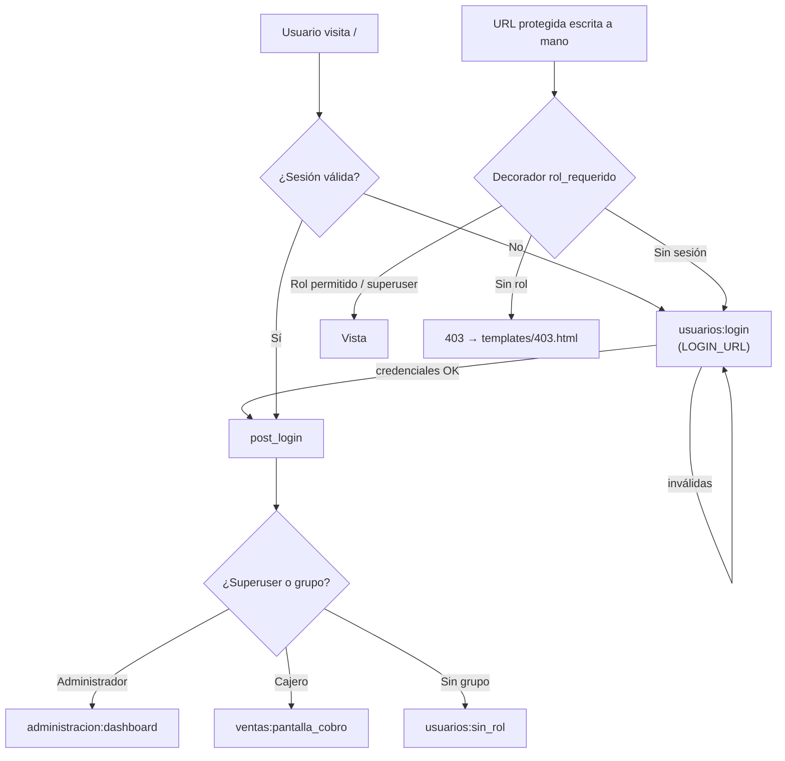
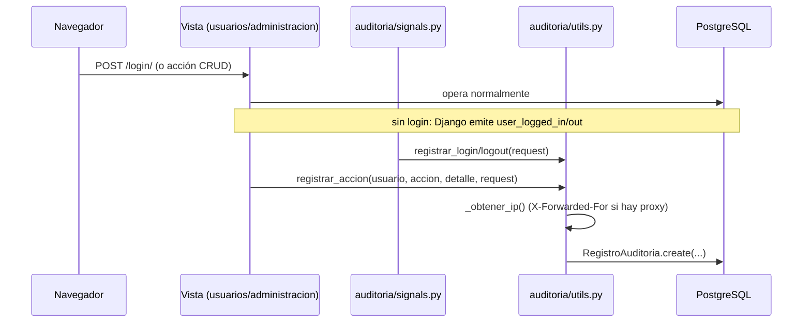

# ARD — Arquitectura y Requerimientos Técnicos

## Sistema Kiosco

| Campo | Valor |
|---|---|
| Documento | ARD v2.6 |
| Fecha | 21/10/2026 |
| Versión del código documentado | `main` (21-10-2026) + HU-13 con el flujo de entrega cerrado, Sprint 4 completo · 340 tests OK |
| Documento relacionado | [PRD — Documento de Requerimientos de Producto](PRD.md) |

> El PRD define el **qué**; este documento define el **cómo**: stack,
> estructura, modelo de datos, superficie de endpoints, decisiones de diseño y
> requerimientos técnicos de calidad. v2.0 incorpora el CRUD de productos con
> HTMX, el módulo de reportes y el estilo neón único; **v2.1** agrega el
> servicio de cobro del Sprint 3 (carrito en sesión, transacción de venta y
> descuento de stock); **v2.2** agrega la app `clientes/` (modelo `Cliente`,
> puntos de fidelidad y asociación en el cobro) y el comando `cargar_demo`;
> **v2.3** agrega el cierre de turno (HU-10): modelo `Turno`, servicios de
> apertura/cierre y pantalla dedicada; **v2.4** agrega la integración externa
> (HU-13): app `pedidos/` con catálogo público sin login, `Pedido`/`ItemPedido`,
> link a WhatsApp configurable y panel de pedidos; **v2.5** agrega la cuenta
> corriente (HU-14): `Cliente.limite_credito`/`saldo_deuda`,
> `PagoCuentaCorriente`, cobro fiado desde el POS con validación de límite y la
> deuda otorgada informada aparte de la caja y de los ingresos; **v2.6** cierra
> el círculo del pedido por WhatsApp (HU-13): **entregar es cobrar**, con
> `Pedido.cliente`/`Pedido.venta`, un servicio de entrega que reutiliza el
> núcleo de venta del POS y la pantalla "Entregar y cobrar".

---

## 1. Visión general de la arquitectura

Estilo: **monolito web MVC/MVT** de Django, server-side rendering con
Django Template Language + HTMX para parciales, sin API JSON ni SPA. Cinco
aplicaciones internas por dominio, una base de datos relacional y un módulo
transversal de auditoría acoplado por señales.

```mermaid
flowchart LR
    B[Navegador<br/>PC del kiosco / móvil] -- HTTP --> M[Django Middleware<br/>sessions, messages, CSRF, auth]

    subgraph Django["Proyecto Django (config/)"]
        M --> U[Routers de URLs]
        U --> V1[usuarios<br/>login · registro · post_login]
        U --> V2[administracion<br/>dashboard · CRUD usuarios · reportes]
        U --> V3[ventas<br/>cobro · catálogo CRUD · cierre de turno]
        U --> V4[clientes<br/>fidelidad · puntos · cuenta corriente]
        U --> V5[pedidos<br/>catálogo público · pedido por WhatsApp]
        V1 --> D1[usuarios/decorators.py<br/>@rol_requerido]
        V2 --> D1
        V3 --> D1
        V4 --> D1
        V5 --solo el panel--> D1
        V2 --> R[administracion/reportes.py<br/>resumen_ventas · top_productos · deuda_otorgada]
        V4 --> SC[clientes/services.py<br/>puntos · cliente en sesión · validar_fiado · registrar_pago]
        V5 --> SP[pedidos/services.py<br/>carrito de pedido en sesión]
        V5 --> CFG[pedidos/config.py<br/>KIOSCO_WHATSAPP · KIOSCO_NOMBRE]
        V1 & V2 & V3 & V4 & V5 --> T[Django Templates<br/>base.html + parciales HTMX]
        T --> CSS[static/css/styles.css<br/>tokens · neón fijo · dark mode]
    end

    V1 & V2 & V3 & V4 & V5 --> DB[(PostgreSQL<br/>fallback SQLite)]
    V1 -.señales user_logged_in/out.-> A[auditoria<br/>RegistroAuditoria]
    V2 --registrar_accion()--> A
    V4 --registrar_accion()--> A
    V5 --registrar_accion()--> A
    A --> DB
    A --> ADM[Django admin<br/>solo lectura]

    DB --> R
    DB --> P[python manage.py<br/>setup_inicial · cargar_demo · migrate · test]
    B -.hx-get / hx-post.-> T
    B -.click "Enviar por WhatsApp".-> W[wa.me<br/>WhatsApp del local]
```

**Flujo de una petición típica:**

1. El navegador envía la petición → middleware (sesión, CSRF, mensajes).
2. El router de `config/urls.py` la deriva al `app_name` correspondiente.
3. El decorador de autorización valida login + rol (403 o `login_required`).
4. La vista consulta el ORM; si la petición trae cabecera `HX-Request`,
   devuelve **solo un partial** (ej. `_productos_tabla.html`); si no, la
   página completa.
5. Si la acción es sensible, se escribe un `RegistroAuditoria`.
6. Django responde HTML; los static se sirven desde `static/`.

> **Consignas de la cátedra:** ambas ✅ **completas.** El **catálogo público
> con pedido por WhatsApp** (HU-13) es la app `pedidos/` (vista sin decorador de
> rol, ruta nueva en `config/urls.py` y modelo `Pedido`); la **cuenta corriente
> "FIAR"** (HU-14) extiende `clientes.Cliente` (`limite_credito`,
> `saldo_deuda`), agrega `PagoCuentaCorriente` y suma el método de pago
> `cuenta_corriente` a `Venta`.

---

## 2. Stack tecnológico

| Capa | Elección | Versión | Justificación |
|---|---|---|---|
| Framework web | Django (MVT) | 6.1.1 | Auth, ORM, forms, mensajes y admin incluidos; ideal para CRUD intensivo con poco equipo |
| Lenguaje | Python | 3.10+ | Consistente con Django; fácil de leer para el equipo |
| Base de datos | PostgreSQL (principal) · SQLite (fallback) | — | Robustez, integridad referencial y tipos `Decimal` para dinero; SQLite permite demo sin instalación |
| Configuración | `django-environ` + `.env` | 0.14.0 | Secretos fuera del repo (`DATABASE_URL`) |
| Driver | psycopg2-binary | 2.9.12 | Conector oficial de PostgreSQL |
| Templates | Django Template Language | — | Server-side rendering, sin build step ni Node |
| Interactividad | **HTMX** (CDN) | 1.9.12 | Búsqueda en tiempo real y futuras acciones del carrito sin JS manual |
| UI framework | Bootstrap 5.3.3 + Bootstrap Icons (CDN) | — | Grid y utilidades sin herramientas de build |
| Tipografía | Google Fonts CDN (Righteous, Space Grotesk) | — | Identidad visual (neón cian) |
| CSS | `static/css/styles.css` con custom properties (~3.400 líneas) | — | Design tokens, estilo neón y modo oscuro sin preprocesador |
| Tests | Django test runner (`manage.py test`; se usa `--keepdb`) | — | 340 tests, sin dependencias extra |
| Cierre de turno | Modelo `Turno` + `services` de apertura/cierre (snapshot) | — | HU-10: totales de caja por método y responsable |
| Catálogo público | App `pedidos/`: vistas sin login + `wa.me` del lado del navegador | — | HU-13: vitrina y pedido para retirar; la config del local sale de `.env` |
| Cuenta corriente | Campos en `Cliente` + `PagoCuentaCorriente` + `services` transaccionales | — | HU-14: límite y deuda por cliente; lo fiado queda fuera de caja e ingresos |
| Auditoría | Señales de Django (`user_logged_in/out`) | — | Sin tocar las vistas de login |
| Datos de demo | Management command `cargar_demo` (semilla fija) | — | Carga reproducible de 56 productos y ventas desde el 20/09/2026 |

**No se usa:** DRF, Celery, Redis, Docker, CI, bundler/`package.json`.

---

## 3. Estructura de módulos

```
kiosco_sprint1/
├── config/              # Proyecto: settings (BD, auth, es-ar), urls raíz, wsgi/asgi
├── usuarios/            # Auth: login/logout, registro, post_login, decoradores de rol,
│                        #   templatetags (paginación/buscador), comando setup_inicial
├── administracion/      # Panel del dueño: dashboard, CRUD de usuarios y reportes
│                        #   (reportes.py: KPIs de ventas y stock)
├── ventas/              # Dominio: Categoria, Producto, Venta, DetalleVenta, Turno,
│                        #   ProductoForm, services.py (carrito/cobro/cierre de turno) y POS
├── clientes/            # Fidelidad (HU-12) + cuenta corriente (HU-14): Cliente,
│                        #   PagoCuentaCorriente, ClienteForm, services.py
│                        #   (puntos, cliente en sesión, validar_fiado,
│                        #   registrar_pago, buscar_clientes, cliente_bloqueado),
│                        #   demo_data.py + comando cargar_demo_clientes
│                        #   y CRUD + asociación en el cobro + cobro de pagos
├── pedidos/             # Integración externa (HU-13): catálogo público sin login,
│                        #   Pedido/ItemPedido, services.py (carrito de pedido en
│                        #   sesión y registrar_entrega)
│                        #   y config.py (KIOSCO_NOMBRE/KIOSCO_WHATSAPP desde .env)
├── auditoria/           # Transversal: RegistroAuditoria + signals + utils (sin urls)
├── templates/           # base.html, 403/404 y templates por app (incl. parciales HTMX)
├── static/              # css/styles.css, img/favicon.svg
├── docs/                # PRD.md y ARD.md (este documento)
├── .env.example         # Plantilla de configuración (BD + WhatsApp del local)
├── manage.py
└── requirements.txt
```

| Módulo | Responsabilidad | Modelos | Endpoints | Tests |
|---|---|---|---|---|
| `config` | Configuración y ruteo raíz | — | `/admin/`, `/` → post_login | — |
| `usuarios` | Identidad, sesiones, autorización por rol | — (usa `auth.User`) | 5 | 9 |
| `administracion` | Gestión de usuarios, dashboard y **reportes** | — (usa `auth.User`/`Group`) | 9 | 24 + 65 |
| `ventas` | Catálogo CRUD y cobro (POS) + cierre de turno | `Categoria`, `Producto`, `Venta`, `DetalleVenta`, `Turno` | 10 | 108 |
| `clientes` | Fidelidad y cuenta corriente: identificación y fiado en el cobro | `Cliente`, `PagoCuentaCorriente` | 10 | 82 |
| `pedidos` | Integración externa: vitrina pública y pedido por WhatsApp | `Pedido`, `ItemPedido` | 9 | 52 |
| `auditoria` | Trazabilidad de acciones | `RegistroAuditoria` | — (solo Django admin) | 0 |

Reglas estructurales:

- Cada app define `app_name` y sus URLs con nombre
  (`ventas:lista_productos`, `clientes:buscar`, `administracion:reportes_ventas`…),
  lo que permite `redirect()` y `reverse()` sin rutas duras.
- `usuarios` y `administracion` no tienen modelos: reutilizan `auth.User`,
  `auth.Group` y las funciones puras de `administracion/reportes.py`
  (consultas ORM sin estado).
- La auditoría **no expone URLs**: es un módulo de servicio consumido por
  señales y por llamadas directas `registrar_accion()`.
- La lógica de catálogo valida en **forms** (`ventas/forms.py::ProductoForm`),
  no en las vistas; igual en clientes (`clientes/forms.py::ClienteForm`).
- `clientes` es la única app con reglas de negocio fuera de ventas: la
  puntuación (`PUNTOS_POR_PESO`), el cliente asociado a la sesión de cobro y la
  cuenta corriente (`validar_fiado`, `sumar_deuda`, `registrar_pago`) viven en
  `clientes/services.py`. `ventas/services.py` la consume como proveedor de
  fidelidad dentro de la transacción de cobro, sin importar `clientes` desde el
  módulo de ventas más allá de eso.
- **El núcleo de venta es uno solo**: `ventas/services.py::registrar_venta_desde_items`
  (descuento de stock, puntos y fiado) lo usan el POS (`confirmar_venta`) y la
  entrega de un pedido (`pedidos/services.py::registrar_entrega`). `pedidos`
  **no** reimplementa el cobro: si mañana cambia la regla de puntos o de fiado,
  cambia en un solo lugar (ADN-18).
- La **búsqueda de clientes** (`clientes/services.py::buscar_clientes`) también
  es una sola: la usan el POS y el panel de pedidos, e **ignora los acentos**
  (en el mostrador nadie escribe tildes).

---

## 4. Modelo de datos

```mermaid
erDiagram
    User ||--o{ Group : "pertenece (grupos)"
    User ||--o{ RegistroAuditoria : "genera"

    Categoria ||--o{ Producto : "agrupa"
    Producto ||--o{ DetalleVenta : "se vende en"
    Venta ||--|{ DetalleVenta : "contiene"
    User ||--o{ Venta : "cobra"
    Cliente ||--o{ Venta : "compra (opcional)"
    Cliente ||--o{ PagoCuentaCorriente : "paga su deuda"
    User ||--o{ Turno : "está a cargo"
    Pedido ||--|{ ItemPedido : "contiene"
    Producto ||--o{ ItemPedido : "se pide (opcional)"
    Pedido }o--o| Cliente : "se cobra a (opcional)"
    Pedido }o--o| Venta : "genera al entregar (opcional)"

    Categoria {
        int id PK
        varchar(100) nombre
        text descripcion "nullable"
    }
    Producto {
        int id PK
        varchar(150) nombre
        text descripcion "nullable"
        varchar(50) codigo_barras "unique, nullable"
        decimal(10,2) precio "venta"
        decimal(10,2) costo "compra, default 0"
        int stock "default 0"
        int stock_minimo "default 5"
        bool activo "default true (baja lógica)"
        int categoria_id FK
    }
    Venta {
        int id PK
        datetime fecha "auto_now_add"
        decimal(10,2) total "default 0"
        bool finalizada "default false"
        varchar(10) metodo_pago "efectivo|tarjeta|cuenta_corriente, default efectivo"
        int usuario_id FK "SET_NULL, null, cajero responsable"
        decimal(10,2) monto_entregado "nullable"
        decimal(10,2) vuelto "nullable"
        int cliente_id FK "SET_NULL, null, fidelidad"
        int puntos_ganados "default 0, 1 cada 100"
    }
    DetalleVenta {
        int id PK
        int cantidad "default 1"
        decimal(10,2) precio_unitario "congelado"
        decimal(10,2) costo_unitario "congelado, default 0"
        int venta_id FK
        int producto_id FK
    }
    Cliente {
        int id PK
        varchar(100) nombre
        varchar(100) apellido
        varchar(20) dni "unique, normalizado"
        varchar(30) telefono "nullable"
        varchar(254) email "nullable"
        datetime fecha_registro "auto_now_add"
        int puntos "default 0"
        decimal(10,2) limite_credito "default 0 = sin cuenta corriente"
        decimal(10,2) saldo_deuda "default 0, deuda vigente"
        bool activo "default true (baja lógica)"
    }
    PagoCuentaCorriente {
        int id PK
        int cliente_id FK "CASCADE"
        decimal(10,2) monto
        datetime fecha "auto_now_add"
        int usuario_id FK "SET_NULL, null, quién cobró"
        varchar(200) observacion "nullable"
    }
    Turno {
        int id PK
        int usuario_id FK "SET_NULL, null, a cargo"
        datetime fecha_apertura "auto_now_add"
        datetime fecha_cierre "nullable, vacío = abierto"
        decimal(10,2) total_efectivo "snapshot al cerrar"
        decimal(10,2) total_tarjeta "snapshot al cerrar"
        decimal(10,2) deuda_otorgada "snapshot al cerrar, no entra a la caja"
        int cantidad_operaciones "snapshot al cerrar"
    }
    Pedido {
        int id PK
        varchar(120) nombre_cliente
        varchar(30) telefono "nullable"
        text comentario "nullable"
        varchar(10) estado "pendiente|entregado|cancelado"
        decimal(10,2) total "congelado al confirmar"
        datetime fecha "auto_now_add"
        int cliente_id FK "SET_NULL, null, se llena al cobrar"
        int venta_id FK "SET_NULL, null, la venta del cobro"
    }
    ItemPedido {
        int id PK
        int pedido_id FK "CASCADE"
        int producto_id FK "SET_NULL, null"
        varchar(150) nombre_producto "congelado"
        int cantidad "default 1"
        decimal(10,2) precio_unitario "congelado"
    }
    RegistroAuditoria {
        int id PK
        int usuario_id FK "SET_NULL, null"
        varchar(255) accion
        text detalle
        datetime fecha "auto_now_add"
        ip ip "nullable"
    }
```

Migraciones de `ventas`: `0001_initial` (catálogo base) ·
`0002_...costo...` (costo de producto y `costo_unitario` de detalle) ·
`0003_...codigo_barras...stock_minimo` ·
`0004_...metodo_pago...monto_entregado...` (Sprint 3: método de pago, cajero,
monto entregado y vuelto) ·
`0005_venta_cliente_venta_puntos_ganados` (HU-12: `Venta.cliente` y
`Venta.puntos_ganados`) ·
`0006_turno` (HU-10: modelo `Turno`) ·
`0007_turno_deuda_otorgada_alter_venta_metodo_pago` (HU-14: `Turno.deuda_otorgada`
y `Venta.metodo_pago` ampliado a 20 para `cuenta_corriente`).
`clientes`: `0001_initial` (modelo `Cliente`) ·
`0002_cliente_limite_credito_cliente_saldo_deuda_and_more` (HU-14:
`Cliente.limite_credito`, `Cliente.saldo_deuda` y modelo
`PagoCuentaCorriente`).
`pedidos`: `0001_initial` (HU-13: modelos `Pedido` e `ItemPedido`) ·
`0002_pedido_cliente_pedido_venta` (cierre de HU-13: `Pedido.cliente` y
`Pedido.venta`, con dependencia de `clientes 0002` y `ventas 0007`).

Notas de diseño:

- **Dinero en `Decimal(10,2)`**, nunca `Float`: evita errores de redondeo.
- **`precio_unitario` y `costo_unitario` en `DetalleVenta`** congelan precio y
  costo al momento de la venta: el margen histórico no cambia si mañana se
  actualiza el producto.
- **`Producto.activo`** permite "borrar" del catálogo sin perder la referencia
  en ventas pasadas (baja lógica, reversible desde editar).
- **`codigo_barras` unique** a nivel de BD + `clean_codigo_barras` en el form:
  la restricción se defiende en dos capas.
- **`stock_minimo`** por producto (default 5) alimenta la property
  `stock_bajo` (`stock ≤ stock_minimo`), usada por la tabla y por los
  reportes.
- Properties de negocio en `Producto`: `margen_unitario`, `margen_porcentual`,
  `valor_stock_costo`, `valor_stock_venta`; en `DetalleVenta`: `subtotal()`,
  `costo_total()`, `ganancia()`.
- **`RegistroAuditoria.usuario` con `SET_NULL`**: si se borra el usuario, el
  registro se conserva.
- **`ItemPedido.nombre_producto` y `precio_unitario` congelados**: igual que
  `DetalleVenta`, el pedido público conserva lo que el cliente vio al armarlo,
  aunque después cambie el precio o se dé de baja el producto
  (`producto` queda con `SET_NULL`).
- **El pedido público no es una venta**: el catálogo genera un `Pedido`, no una
  `Venta`. La venta real (y el descuento de stock) siguen ocurriendo en el POS
  cuando el cliente pasa por el local a retirar.
- **Entregar es cobrar (cierre de HU-13):** `Pedido.cliente` y `Pedido.venta`
  (ambos `SET_NULL`) son el vínculo entre el pedido de WhatsApp y el cobro real
  en el mostrador. La referencia va **de `pedidos` hacia `ventas.Venta`** (y no
  al revés) para no crear una dependencia circular de migraciones: `ventas` no
  sabe nada de `pedidos`. Ver ADN-18.
- **El precio del pedido manda:** al entregar se cobra el
  `ItemPedido.precio_unitario` congelado (lo que el cliente vio), no el
  `Producto.precio` del momento.
- **Campos del Sprint 3** (PRD RF-41, riesgo R-04 ✅): `Venta.metodo_pago`
  (choices `efectivo`/`tarjeta`), `Venta.usuario` (`SET_NULL`, cajero
  responsable), `monto_entregado` y `vuelto`.
- **Fidelidad (HU-12, Sprint 4):** `Cliente` con `dni` único y normalizado por
  el form; `Venta.cliente` con `SET_NULL` (borrar un cliente no rompe la venta
  histórica) y `Venta.puntos_ganados`, que **congela la regla de puntos**
  vigente al momento de la venta (hoy 1 cada $100 en
  `clientes/services.py::PUNTOS_POR_PESO`).
- **`Cliente.activo`** aplica la misma baja lógica que `Producto`: el cliente
  dado de baja conserva su historial y sus puntos, pero no puede asociarse a
  ventas nuevas.
- **`|montos`** (ADN-12) es el único formato de dinero válido en templates,
  mensajes y auditoría.
- **Cierre de turno (HU-10, Sprint 4):** `Turno` guarda `usuario` (`SET_NULL`),
  `fecha_apertura`, `fecha_cierre` (vacía = abierto) y el **snapshot** de
  `total_efectivo`, `total_tarjeta`, `deuda_otorgada` y `cantidad_operaciones`.
  Los totales se congelan al cerrar para que el histórico no cambie si después se
  registran más ventas (ver ADN-15).
- **Cuenta corriente (HU-14, consigna):** `Cliente.limite_credito`
  (`default 0` = sin cuenta corriente) y `Cliente.saldo_deuda` (deuda vigente)
  persistidos en el cliente; `PagoCuentaCorriente` guarda el historial de pagos
  (`monto`, `fecha`, `usuario` y `observacion`) y sobrevive a la baja lógica del
  cliente. `Venta.metodo_pago` suma el choice `cuenta_corriente` (por eso
  `max_length` pasó a 20) y la deuda **no** entra a la caja: se informa aparte
  como *deuda otorgada* (ver ADN-17).
- Las consignas nuevas de la cátedra quedaron **completas**: el **catálogo
  público (HU-13)** tiene modelos propios (`Pedido`/`ItemPedido` en la app
  `pedidos`) y se vincula a la `Venta` del cobro **desde `pedidos`**
  (`Pedido.venta`), sin que `ventas` dependa de `pedidos`; la **cuenta corriente
  (HU-14)** vive en `clientes` + `ventas` y no agrega tablas nuevas fuera de
  `PagoCuentaCorriente`.
- `usuarios` y `administracion` no agregan tablas: usan `auth_user`,
  `auth_group` y `auth_user_groups`.

---

## 5. Superficie de endpoints

Ruteo raíz (`config/urls.py`): `/admin/` → Django admin · `/` →
`usuarios:post_login` · `/catalogo/`, `/usuarios/`, `/clientes/`, `/ventas/`,
`/administracion/` → includes.

### 5.1 `usuarios` (`/usuarios/`)

| Ruta | Nombre | Métodos | Control de acceso |
|---|---|---|---|
| `/usuarios/login/` | `usuarios:login` | GET/POST | Público (autenticados → `post_login`) |
| `/usuarios/logout/` | `usuarios:logout` | POST | Autenticado |
| `/usuarios/post-login/` | `usuarios:post_login` | GET | `@login_required` + redirige por rol |
| `/usuarios/sin-rol/` | `usuarios:sin_rol` | GET | `@login_required` |
| `/usuarios/registro/` | `usuarios:registro` | GET/POST | Público (el usuario nace sin rol) |

### 5.2 `administracion` (`/administracion/`) — todas con `@rol_requerido("Administrador")`

| Ruta | Nombre | Métodos | Control de acceso |
|---|---|---|---|
| `/administracion/dashboard/` | `administracion:dashboard` | GET | Admin (403 al resto) |
| `/administracion/usuarios/` | `listar_usuarios` | GET (`?buscar=&estado=&rol=`) | Admin |
| `/administracion/usuarios/crear/` | `crear_usuario` | GET/POST | Admin |
| `/administracion/usuarios/<id>/editar/` | `editar_usuario` | GET/POST | Admin |
| `/administracion/usuarios/<id>/eliminar/` | `eliminar_usuario` | GET (confirmación) / POST | Admin + protecciones |
| `/administracion/usuarios/<id>/roles/` | `asignar_roles` | GET/POST | Admin |
| `/administracion/usuarios/<id>/toggle/` | `toggle_usuario` | GET ⚠ | Admin + protecciones (R-03) |
| `/administracion/reportes/ventas/` | `reportes_ventas` | GET (`?desde=&hasta=`) | Admin |
| `/administracion/reportes/stock/` | `reportes_stock` | GET | Admin |

### 5.3 `ventas` (`/ventas/`)

| Ruta | Nombre | Métodos | Control de acceso |
|---|---|---|---|
| `/ventas/cobro/` | `ventas:pantalla_cobro` | GET (`?venta=<id>` muestra el comprobante) | `@login_required` (Cajero y Administrador) |
| `/ventas/cobro/buscar/` | `ventas:cobro_buscar` | GET (`?codigo=`) | `@login_required` · búsqueda en tiempo real (≥3 caracteres) → partial `_cobro_resultados.html` |
| `/ventas/cobro/agregar/` | `ventas:cobro_agregar` | POST (HTMX) | `@login_required` · responde partial `_carrito.html` |
| `/ventas/cobro/cantidad/` | `ventas:cobro_cantidad` | POST (HTMX) | `@login_required` · sumar/restar/quitar ítem |
| `/ventas/cobro/confirmar/` | `ventas:cobro_confirmar` | POST (HTMX) | `@login_required` · confirma la venta (efectivo/tarjeta/**cuenta_corriente**) y redirige con `?venta=` |
| `/ventas/turno/cierre/` | `ventas:cierre_turno` | GET (`?turno=<id>` muestra el resumen) / POST (abrir/cerrar) | `@login_required` · solo el responsable del turno o el Administrador (turno ajeno → 403) |
| `/ventas/productos/` | `ventas:lista_productos` | GET (`?buscar=&orden=&direccion=`) | `@rol_requerido("Administrador")` · responde partial si `HX-Request` · orden por columna con whitelist `CAMPOS_ORDEN` |
| `/ventas/productos/agregar/` | `ventas:agregar_producto` | GET/POST | `@rol_requerido("Administrador")` |
| `/ventas/productos/<id>/editar/` | `ventas:editar_producto` | GET/POST | `@rol_requerido("Administrador")` |
| `/ventas/productos/<id>/eliminar/` | `ventas:eliminar_producto` | GET (confirmación) / POST (baja lógica) | `@rol_requerido("Administrador")` |

Las 5 rutas de cobro comparten `_contexto_cobro()` (lee el carrito de la
sesión, hidrata los productos y calcula el total) y devuelven el parcial
`_carrito.html` cuando la petición trae cabecera `HX-Request`. El token CSRF
se envía globalmente vía `hx-headers` en `base.html`. El escáner busca
en tiempo real con `hx-get` + `hx-trigger="input changed delay:300ms"`
(desde 3 caracteres) y agrega con un clic desde los resultados.

### 5.4 `clientes` (`/clientes/`) — fidelidad y cuenta corriente (HU-12 / HU-14)

| Ruta | Nombre | Métodos | Control de acceso |
|---|---|---|---|
| `/clientes/` | `clientes:listar_clientes` | GET (`?buscar=`) | `@rol_requerido("Administrador")` · responde partial `_clientes_tabla.html` si `HX-Request` |
| `/clientes/crear/` | `clientes:crear_cliente` | GET/POST | `@rol_requerido("Administrador")` · incluye `limite_credito` |
| `/clientes/<id>/` | `clientes:detalle_cliente` | GET | `@rol_requerido("Administrador")` · ficha con puntos, historial, cuenta corriente e historial de pagos |
| `/clientes/<id>/editar/` | `clientes:editar_cliente` | GET/POST | `@rol_requerido("Administrador")` · permite editar el límite |
| `/clientes/<id>/eliminar/` | `clientes:eliminar_cliente` | GET (confirmación) / POST (baja lógica) | `@rol_requerido("Administrador")` |
| `/clientes/<id>/pagos/registrar/` | `clientes:registrar_pago` | POST | `@rol_requerido("Administrador")` · cobra un pago de la deuda; el cajero recibe 403 |
| `/clientes/buscar/` | `clientes:buscar` | POST (HTMX) | `@login_required` · búsqueda por DNI desde el cobro |
| `/clientes/asociar/` | `clientes:asociar` | POST (HTMX) | `@login_required` · guarda el cliente en `session["cliente_id"]` |
| `/clientes/quitar/` | `clientes:quitar` | POST (HTMX) | `@login_required` · desasocia el cliente del carrito |
| `/clientes/alta-rapida/` | `clientes:alta_rapida` | POST (HTMX) | `@login_required` · crea el cliente y lo asocia en un paso |

El CRUD y el **registro de pagos** son de Administrador (el cajero recibe 403);
las rutas del cobro son de `@login_required` porque el cajero debe poder
identificar al cliente sin salir del POS. El cliente se guarda en la sesión y
recién se ata a la `Venta` en `confirmar_venta()`. Cuando el cobro se hace a
**cuenta corriente**, además de la venta se valida el límite y se suma la deuda
en la misma transacción (`clientes/services.py::validar_fiado`/`sumar_deuda`).

### 5.5 `pedidos` (`/catalogo/`) — integración externa (HU-13)

| Ruta | Nombre | Métodos | Control de acceso |
|---|---|---|---|
| `/catalogo/` | `pedidos:catalogo` | GET (`?categoria=`) | **Público (sin login)** |
| `/catalogo/agregar/` | `pedidos:pedido_agregar` | POST (HTMX) | Público · responde partial `_carrito_pedido.html` |
| `/catalogo/quitar/` | `pedidos:pedido_quitar` | POST (HTMX) | Público · quita un ítem del pedido en curso |
| `/catalogo/confirmar/` | `pedidos:pedido_confirmar` | POST | Público · persiste el `Pedido` y muestra el paso a WhatsApp (`?accion=vaciar` limpia el pedido) |
| `/catalogo/panel/` | `pedidos:lista_pedidos` | GET (`?estado=&buscar=`) | `@rol_requerido("Administrador")` · partial `_pedidos_tabla.html` si `HX-Request` |
| `/catalogo/panel/<id>/` | `pedidos:detalle_pedido` | GET | `@rol_requerido("Administrador")` · muestra el formulario "Entregar y cobrar" si el pedido está pendiente |
| `/catalogo/panel/clientes/buscar/` | `pedidos:buscar_cliente` | GET (`?q=`) | `@rol_requerido("Administrador")` · partial `_resultados_cliente.html` (HTMX) · búsqueda **sin acentos** |
| `/catalogo/panel/<id>/entregar/` | `pedidos:entregar` | POST | `@rol_requerido("Administrador")` · cobra el pedido y lo marca entregado (auditado) |
| `/catalogo/panel/<id>/estado/<estado>/` | `pedidos:cambiar_estado` | POST | `@rol_requerido("Administrador")` · solo **cancelar** (auditado) · el estado `entregado` se rechaza: para entregar hay que cobrar |

El catálogo es la **única superficie pública** además del login: no lleva
decorador de rol y muestra la disponibilidad como **"Disponible" / "Agotado"**
(nunca la cantidad exacta de stock). El carrito del pedido vive en
`session["pedido"]`, separado del carrito del POS (`session["carrito"]`). El
teléfono del local se lee de `pedidos/config.py` (`KIOSCO_WHATSAPP`); el link
`wa.me` se arma en el servidor y lo abre el navegador.

**Entregar es cobrar:** el pedido no tiene un botón "marcar entregado". El
Administrador cobra en el mostrador (cliente opcional, método de pago y monto)
y esa acción crea la `Venta`, descuenta el stock, suma los puntos y, si es
cuenta corriente, valida el límite y suma la deuda — con el mismo servicio que
usa el POS (`ventas.services.registrar_venta_desde_items`). El pedido queda
`entregado` con `Pedido.venta` y `Pedido.cliente` ya seteados. Todo ocurre en
una sola transacción con el pedido bloqueado (`select_for_update`): o se cobra
y se entrega, o no pasa nada.

⚠ = deuda abierta en el PRD (R-03: cambio de estado por GET). El Django admin
(`/admin/`) queda como herramienta de respaldo.

---

## 6. Autenticación y autorización

**Mecanismo:** roles como **Django Groups** (`Administrador`, `Cajero`) sobre
`auth.User`, no permisos individuales por modelo.



Piezas clave (`usuarios/decorators.py`):

| Pieza | Uso | Comportamiento |
|---|---|---|
| `es_administrador(user)` / `es_cajero(user)` | Consultas de rol | Superuser bypassea siempre |
| `@rol_requerido(*roles)` | Vistas función | `login_required` + chequeo de grupo → `PermissionDenied` (403) |
| `RolRequeridoMixin` | CBVs | Mismo criterio para clases; reservado para futuras `ListView`/`CreateView` |

Configuración de auth (`config/settings.py`):
`LOGIN_URL='usuarios:login'` · `LOGIN_REDIRECT_URL='usuarios:post_login'` ·
`LOGOUT_REDIRECT_URL='usuarios:login'`.

Flujo de `post_login`: `es_administrador` → dashboard · `es_cajero` → cobro ·
sin grupo → `sin_rol`. El registro público crea cuentas sin grupo a propósito:
el rol lo asigna un administrador (RF-14).

**Mapa de protección actual:**

| Zona | Cajero | Admin |
|---|---|---|
| Pantalla de cobro | ✅ | ✅ |
| Búsqueda/asociación de cliente en el cobro | ✅ | ✅ |
| Cobrar "FIAR" a cuenta corriente desde el POS | ✅ | ✅ |
| Registrar pagos de la deuda / editar el límite | 403 | ✅ |
| Cierre de turno (el turno propio) | ✅ | ✅ |
| Cierre de turno de otro cajero | 403 | ✅ |
| CRUD de clientes (ficha, alta, edición, baja) | 403 | ✅ |
| Catálogo de productos | 403 | ✅ |
| Reportes de ventas/stock | 403 | ✅ |
| Dashboard y gestión de usuarios | 403 | ✅ |
| Panel de pedidos del catálogo público | 403 | ✅ |
| Catálogo público y armado de pedido | ✅ (público) | ✅ (público) |
| Auditoría (Django admin) | 403 | ✅ |

**Criterios de seguridad aplicados:**

- Autorización siempre **server-side** (el 403 no depende de la UI); testeado
  (`test_no_muestra_costos_al_cajero`, tests de 403 en reportes).
- Todos los POST con token CSRF; logout solo por POST.
- Contraseñas con los hashers y validadores de Django (longitud ≥ 6).
- Protecciones de negocio: no eliminación/desactivación de la cuenta propia ni
  de superusuarios (RF-15).
- Deuda abierta: `toggle_usuario` se dispara por GET (R-03).

---

## 7. Auditoría (arquitectura transversal)



- **Automático:** `user_logged_in` / `user_logged_out` conectados en
  `AuditoriaConfig.ready()`.
- **Manual:** `registrar_accion()` invocado desde las vistas de
  `administracion` en cada operación de escritura (crear, editar, eliminar,
  roles, toggle) y desde `clientes` en el alta/edición/baja de un cliente.
- **Entrega de pedidos:** `pedidos:entregar` audita con
  `registrar_accion("Pedido #N entregado")` y un detalle con el número de
  venta, el importe, el método de pago y el cliente (más los puntos ganados).
- **Conservación:** `usuario` con `SET_NULL`; los registros sobreviven al
  borrado del usuario.
- **Lectura:** `auditoria/admin.py` registra el modelo en **solo lectura**
  (add/change/delete deshabilitados). No hay UI propia (RF-62 pendiente) ni
  tests (R-08).

---

## 8. Capa de presentación

| Aspecto | Decisión |
|---|---|
| Layout | `templates/base.html` con blocks `titulo` y `contenido`; navbar solo si `user.is_authenticated` (marca, usuario, badge de rol, botón de tema, logout POST, filete de toldo) |
| Estructura de templates | `templates/<app>/…` en paralelo a las apps; páginas de error globales `403.html` / `404.html` |
| Plantillas de página | `templates/ventas/cierre_turno.html` (apertura, totales en vivo, deuda otorgada y resumen del turno); `templates/clientes/detalle_cliente.html` (ficha con puntos, historial de ventas, cuenta corriente e historial de pagos); `templates/pedidos/catalogo.html` (vitrina pública), `pedidos/pedido_confirmado.html` (paso a WhatsApp), `pedidos/lista_pedidos.html` y `pedidos/detalle_pedido.html` (panel interno, con la card **"Entregar y cobrar"**: buscador de cliente, métodos de pago, monto entregado y vuelto en vivo) |
| Parciales HTMX | `ventas/_productos_tabla.html` (búsqueda/orden), `ventas/_carrito.html` (carrito + form de pago del POS, con la opción "FIAR" y la barra de cuenta corriente), `ventas/_cobro_resultados.html` (sugerencias del escáner), `clientes/_clientes_tabla.html` (lista de clientes con la deuda o el límite), `clientes/_resultados_cobro.html` (búsqueda + alta rápida del cliente), `pedidos/_carrito_pedido.html` (pedido público), `pedidos/_pedidos_tabla.html` (panel de pedidos), `pedidos/_resultados_cliente.html` (buscador de cliente del panel de pedidos), `usuarios/tags/paginacion.html` y `usuarios/tags/buscador.html` |
| Cuenta corriente en la UI | Barra de crédito en el cobro (deuda, límite y disponible), opción "Cobrar a Cuenta Corriente" solo si el cliente puede fiar, tarjeta de deuda e historial de pagos en la ficha del cliente, y "Deuda otorgada (FIAR)" aparte en el cierre de turno y en los reportes (aviso de que no es plata en caja) |
| Entrega de un pedido (HU-13) | Card "Entregar y cobrar" en `pedidos/detalle_pedido.html`: buscador de cliente por HTMX (**sin acentos**), métodos de pago (efectivo/tarjeta/cuenta corriente), monto entregado con **vuelto en vivo** y botón "Entregar y cobrar · $total". El bloque del monto se oculta solo con efectivo. La opción "Cobrar a cuenta corriente" solo se habilita si el cliente elegido tiene cuenta corriente habilitada. El cliente es **opcional**: sin cliente, la venta queda como consumidor final |
| HTMX | CDN `htmx.org@1.9.12` al final de `base.html`; las vistas detectan `request.headers.get("HX-Request")` y devuelven solo el partial |
| Búsqueda de productos | `hx-get` al input con `hx-trigger="keyup changed delay:300ms, search"` y `hx-target="#contenedor-tabla"` (sin recarga) |
| Estilos | **Un solo estilo: neón cian**, forzado con `data-tema="neon"` en el `<head>` de `base.html`; las paletas Cartelera y Ticket fueron eliminadas |
| Modo oscuro | `data-theme` (`light`/`dark`) en `<html>`; persistencia en `localStorage['kiosco-tema']` con script sin destello y respeto de `prefers-color-scheme`; botón `#darkToggle` |
| Tokens | Custom properties en `:root` + variantes `[data-theme="dark"]`; una paleta definida una vez, reutilizada en todos los componentes |
| Accesibilidad | Contraste AA, `focus-visible`, `aria-label` en el botón de tema, `@media (prefers-reduced-motion: reduce)` |
| Responsivo | Navbar colapsa en mobile; login a panel único bajo 900px |
| Sin build | Todo JS es inline o por CDN; no hay `package.json` ni bundler |

---

## 9. Configuración y entorno

| Setting | Valor | Observación |
|---|---|---|
| `DJANGO_SETTINGS_MODULE` | `config.settings` | vía `manage.py` |
| Base de datos | `env.db('DATABASE_URL')` con fallback `sqlite:///…/db.sqlite3` | `.env` solo con `DATABASE_URL` (gitignore) |
| `DEBUG` / `SECRET_KEY` / `ALLOWED_HOSTS` | `True` / clave de desarrollo / `[]` | Hardcodeados — deuda R-06 antes de producir |
| Locale | `LANGUAGE_CODE='es-ar'`, `TIME_ZONE='America/Argentina/Buenos_Aires'`, `USE_TZ=True` | Formato argentino |
| Static | `STATIC_URL='static/'`, `STATICFILES_DIRS=[BASE_DIR/'static']` | Sirve Django en dev |
| Templates | `DIRS=[BASE_DIR/'templates']` + `APP_DIRS` | Directorio global por delante de los de app |
| Correo | bloque `MAILERS` (no es un setting válido de Django) | Sin `EMAIL_BACKEND` → no hay envío de mails (R-10) |
| Seed | `python manage.py setup_inicial` | Crea grupos + `admin`/`cajero1`; idempotente |
| Datos de demo | `python manage.py cargar_demo [--limpiar] [--ventas-por-dia N]` | 56 productos + ventas desde el 20/09/2026 con semilla fija |
| Datos de demo de clientes | `python manage.py cargar_demo_clientes [--limpiar]` | Clientes **con compras reales** + pedidos de WhatsApp (los entregados se cobran con `registrar_entrega`). Va **después** de `cargar_demo` |

Comandos del proyecto:

| Tarea | Comando |
|---|---|
| Migraciones | `python manage.py migrate` |
| Seed | `python manage.py setup_inicial` |
| Datos de demo | `python manage.py cargar_demo --limpiar` |
| Datos de demo de clientes y pedidos | `python manage.py cargar_demo_clientes --limpiar` (después de `cargar_demo`) |
| Servidor | `python manage.py runserver 8001` (puerto fijo del equipo) |
| Tests | `python manage.py test --keepdb` |

---

## 10. Decisiones de diseño (mini-ADR)

### ADN-01 — Roles con Django Groups, no permisos por modelo

- **Contexto:** el pedido es binario ("el cajero solo ve cobro").
- **Decisión:** grupos `Administrador` / `Cajero` + `@rol_requerido`.
- **Consecuencias:** implementación simple y testeable; para permisos finos
  ("ve stock pero no edita precio") habrá que migrar a
  `django.contrib.auth.models.Permission`.

### ADN-02 — `usuarios` y `administracion` sin modelos propios

- **Contexto:** no se pidió un perfil extendido de usuario.
- **Decisión:** reutilizar `auth.User` y `auth.Group`.
- **Consecuencias:** cero migraciones propias; si más adelante hace falta
  teléfono/DNI de cajeros, se agregará un modelo `Perfil` con OneToOne (o el
  modelo `Cliente` del Sprint 4, que es para consumidores).

### ADN-03 — Autorización con decorador en vez de middleware o permisos

- **Contexto:** proteger todas las rutas sensibles con el mismo criterio.
- **Decisión:** decorador `rol_requerido` (vistas función) + `RolRequeridoMixin`
  (CBVs, para uso futuro).
- **Consecuencias:** control explícito y visible por vista; un olvido deja la
  ruta "solo con login". Caso histórico: el catálogo de `ventas` quedó sin rol
  y se corrigió en el Sprint 2.

### ADN-04 — Redirección post-login centralizada en `post_login`

- **Contexto:** admin y cajero deben caer en pantallas distintas.
- **Decisión:** una sola vista que despacha según rol (`LOGIN_REDIRECT_URL`).
- **Consecuencias:** un único punto de control y de test; agregar un rol
  implica tocar solo esa vista.

### ADN-05 — Auditoría por señales en lugar de código en las vistas

- **Contexto:** registrar logins sin acoplar el módulo de auditoría al de auth.
- **Decisión:** señales `user_logged_in/out` + helper `registrar_accion()` para
  acciones de negocio.
- **Consecuencias:** desacople y cero cambios en las vistas de login; a cambio,
  el flujo es menos explícito y sigue sin cobertura de tests.

### ADN-06 — Monolito server-side rendering con HTMX, sin API ni SPA

- **Contexto:** equipo chico, entregas quincenales, CRUD dominante.
- **Decisión:** Django + DTL + Bootstrap por CDN, **HTMX para parciales**
  (búsqueda de productos y carrito de cobro).
- **Consecuencias:** arranque instantáneo y deploy simple; la interacción en
  tiempo real se responde con fragments HTML en vez de JSON.

### ADN-07 — PostgreSQL con fallback a SQLite

- **Contexto:** la consigna pide PostgreSQL, pero las demos deben correr sin
  servidor de BD.
- **Decisión:** `DATABASE_URL` vía `.env` con default SQLite.
- **Consecuencias:** cero fricción para el equipo; riesgo de que alguien
  desarrolle sobre SQLite y haya diferencias sutiles (se usa `Decimal` e
  integridad referencial, compatibles con ambos).

### ADN-12 — Un solo formato de dinero en toda la UI (`|montos`)

- **Contexto:** los importes se mostraban con la localización por defecto
  (`1500,00`) y en los reportes con `floatformat:2`, con decimales de más
  para los totales del kiosco.
- **Decisión:** filtro propio `usuarios/templatetags/formatos.py::montos`
  (entero → miles con punto y sin decimales; solo muestra centavos si los
  hay) y `services.formatear_monto()` reutilizando el mismo filtro, para que
  pantallas, mensajes y auditoría digan lo mismo.
- **Consecuencias:** formato legible para el cajero (`$26.100` en vez de
  `$26100,00`); si algún día se necesita factura con centavos exactos, el
  filtro ya los emite cuando no son cero.

### ADN-08 — Validación de catálogo en Forms, no en las vistas

- **Contexto:** alta/edición de producto con código de barras único y
  categoría nueva.
- **Decisión:** `ProductoForm` con `clean_codigo_barras` y
  `clean_precio`; la vista solo arma el POST (crea la categoría con
  `get_or_create` si vino "categoría nueva") y hace `form.is_valid()`.
- **Consecuencias:** reutilizable entre alta y edición, errores de validación
  en la UI y mensajes consistentes.

### ADN-09 — Reportes como funciones puras de consulta

- **Contexto:** el Sprint 4 pedía KPIs de ventas y stock.
- **Decisión:** `administracion/reportes.py` con funciones que reciben rango
  de fechas y devuelven primitivas/dicts (`resumen_ventas`, `ventas_por_dia`,
  `top_productos`, `productos_mas_rentables`, `resumen_stock`,
  `stock_por_categoria`, `productos_bajo_margen`); las vistas solo orquestan
  y renderizan.
- **Consecuencias:** lógica testeable sin HTTP (57 tests) y reutilizable en
  el cierre de turno del Sprint 4.

### ADN-10 — Baja lógica de productos

- **Contexto:** un producto vendido no puede borrarse sin romper la historia.
- **Decisión:** `activo=False` en vez de `DELETE`; la lista muestra todos y
  editar permite reactivar.
- **Consecuencias:** integridad referencial preservada; el cobro del Sprint 3
  solo permite productos `activo=True`.

### ADN-11 — El carrito vive en la sesión, no en la base de datos

- **Contexto:** HU-07/08 necesitan un carrito editable antes de cobrar, pero
  una `Venta` a medias en la BD arruinaría los reportes (que promedian y
  agregan por `Venta`).
- **Decisión:** carrito como lista de `{"producto_id", "cantidad"}` en
  `request.session["carrito"]`; la `Venta` recién se crea dentro de
  `services.confirmar_venta()`, en una transacción que congela precios,
  descuenta stock y guarda método de pago y vuelto.
- **Consecuencias:** cero migraciones y ninguna fila parcial; el carrito es
  por navegador (no se comparte entre PCs ni sobrevive al cierre de sesión) y
  el total se recalcula en cada request a partir de los precios vigentes.

### ADN-13 — Fidelidad como app propia, con los puntos congelados en la venta

- **Contexto:** HU-12 pide identificar al cliente en el cobro y acumular
  puntos. El modelo `Cliente` no es un usuario del sistema (no inicia sesión)
  y la regla de puntos es una decisión de negocio que puede cambiar.
- **Decisión:** app `clientes/` con el modelo `Cliente` y
  `clientes/services.py` (regla `PUNTOS_POR_PESO`, cliente en sesión, suma de
  puntos); la `Venta` guarda `cliente` (`SET_NULL`) y `puntos_ganados`, en vez
  de recalcular el saldo a partir del historial.
- **Consecuencias:** el saldo del cliente es un acumulador simple
  (`Cliente.puntos`) y cada venta conserva sus propios puntos, así que cambiar
  la regla no reescribe la historia; dar de baja un cliente no borra sus
  ventas ni sus puntos. El costo es que `puntos` y los `puntos_ganados` de las
  ventas podrían desincronizarse si alguien edita uno sin el otro (hoy no hay
  UI para ajustar puntos a mano).

### ADN-14 — Cuenta corriente ("FIAR"): límite por cliente y deuda guardada

- **Contexto:** la cátedra pidió "FIAR" con límite máximo por cliente. Antes de
  implementarlo (v2.2) quedaron abiertas las decisiones de negocio: dónde vive
  el límite y si la deuda se **guarda** o se **calcula**.
- **Decisión (resuelta el 19-10, HU-14):**
  - El límite es **por cliente**: `Cliente.limite_credito` (0 = sin cuenta
    corriente), editable solo por el Administrador desde el alta/edición.
  - La deuda se **guarda** en `Cliente.saldo_deuda` y cada cobro deja un
    `PagoCuentaCorriente` (historial auditable).
  - El **cajero** puede fiar desde el POS (`Venta.metodo_pago = "cuenta_corriente"`),
    pero **solo el Administrador** registra pagos y edita el límite.
  - Lo fiado **no entra a la caja ni a los ingresos**: se informa aparte como
    *deuda otorgada*.
- **Consecuencias:** el saldo es un acumulador rápido de leer (no hay que sumar
  ventas y pagos cada vez), a costa de que la fuente de verdad sea el campo y no
  el historial; el historial de pagos queda como respaldo y para la UI. La
  validación del límite y la suma de la deuda ocurren **dentro de la misma
  transacción** de `confirmar_venta` (con `select_for_update`), así que dos
  cobros simultáneos no pueden pasarse del límite por una condición de carrera.
  Dar de baja un cliente conserva su deuda y sus pagos.

### ADN-15 — El cierre de turno congela un snapshot de los totales

- **Contexto:** HU-10 pide saber cuánta plata entró en efectivo y tarjeta en un
  turno. Si el resumen se calculara siempre "en vivo", registrar una venta con
  fecha retroactiva (o un ajuste posterior) cambiaría el total de un turno ya
  cerrado y ya contado.
- **Decisión:** `Turno` guarda los totales (`total_efectivo`, `total_tarjeta`,
  `deuda_otorgada`, `cantidad_operaciones`) como **snapshot congelado** en el
  momento del cierre, dentro de una transacción con `select_for_update`.
  Mientras el turno está abierto, `totales_del_turno()` calcula en vivo; una vez
  cerrado, devuelve el snapshot.
- **Consecuencias:** el histórico de cierres es inmutable y auditable. El
  turno abierto es por usuario (no puede haber dos a la vez) y las ventas se
  atribuyen al responsable por su franja de fechas. `total_efectivo` y
  `total_tarjeta` suman **solo** los métodos en `METODOS_EN_CAJA`
  (`efectivo`, `tarjeta`); lo fiado a cuenta corriente se acumula aparte en
  `deuda_otorgada` y **no** engrosa la caja (resuelve el riesgo R-14).

### ADN-16 — El catálogo público registra un `Pedido`, no una `Venta`

- **Contexto:** HU-13 pide que el vecino vea el catálogo sin login, arme su
  pedido y lo mande por WhatsApp. El riesgo (R-13) era que el pedido viviera
  solo en el chat y el kiosquero lo perdiera.
- **Decisión:** el pedido se **persiste** como `Pedido`/`ItemPedido` *además*
  del mensaje de WhatsApp, que se arma del lado del navegador con `wa.me`
  (sin API ni credenciales). **No** es una `Venta`: no descuenta stock ni entra
  a la caja; el cobro real pasa en el POS cuando el cliente retira. El carrito
  del pedido vive en `session["pedido"]`, aparte del carrito del POS.
- **Vitrina sin cantidades:** la vista pública muestra solo **"Disponible" /
  "Agotado"** (`stock > 0`), nunca el número exacto, para no exponer el
  inventario del local.
- **Consecuencias:** el kiosquero tiene una comanda con estado
  (`pendiente`/`entregado`/`cancelado`, cambios auditados) y el pedido se
  conserva aunque el cliente cierre el chat. `ItemPedido` congela nombre y
  precio (ADN-02) y su `producto` usa `SET_NULL` para sobrevivir a una baja de
  catálogo. La configuración del local (`KIOSCO_NOMBRE`, `KIOSCO_WHATSAPP`)
  sale de `.env` (`pedidos/config.py`) y, si el WhatsApp no está cargado, la
  pantalla avisa en vez de abrir un chat a un número de mentira.

### ADN-17 — Lo fiado se informa como "deuda otorgada", fuera de caja e ingresos

- **Contexto:** una venta a cuenta corriente es una venta (descuenta stock y
  suma puntos), pero **no** es plata que entró. Sumarla a los ingresos o a la
  caja inflaría el arqueo y los reportes (riesgo R-14).
- **Decisión:** `METODOS_EN_CAJA = ("efectivo", "tarjeta")` en
  `ventas/services.py` define qué suma a la caja. Los reportes de ingresos
  llaman a `reportes.ventas_del_rango(..., incluir_fiado=False)` y existe una
  función dedicada `reportes.deuda_otorgada()`; en la UI se muestra siempre
  **"Deuda otorgada (FIAR)"** en una tarjeta aparte, con un aviso de que no es
  plata que esté en la caja.
- **Consecuencias:** los KPIs de ingresos, la serie por día, el top de productos
  y los más rentables **excluyen** lo fiado; el listado de ventas del reporte sí
  muestra todas las ventas (incluidas las fiadas) para poder auditar cada
  operación. El cierre de turno congela `deuda_otorgada` en el snapshot
  (ADN-15). La regla queda centralizada en una constante, así que sumar mañana
  otro método cobrable es un cambio de una línea.

### ADN-18 - Entregar un pedido es cobrarlo (no hay "marcar entregado")

- **Contexto:** con el flujo viejo (ADN-16) el pedido público se cobraba en el
  POS, pero el panel tenía un botón "Marcar como entregado" que solo cambiaba
  el estado. Eso dejaba dos verdades: un pedido podía quedar "entregado" sin
  ninguna `Venta` (y sin stock descontado), y la demo mostraba clientes cargados
  sin ninguna compra real.
- **Decisión:** **no existe el estado "entregado" sin venta**. La entrega pasa
  por `pedidos.services.registrar_entrega`, que:
  1. bloquea el pedido (`select_for_update`) y valida que siga pendiente;
  2. arma los ítems con el **precio congelado** del pedido (`ItemPedido.precio_unitario`)
     y el **costo actual** del producto;
  3. llama al **núcleo de venta del POS** (`ventas.services.registrar_venta_desde_items`),
     que descuenta stock, suma los puntos y, si es cuenta corriente, valida el
     límite y suma la deuda;
  4. deja el pedido `entregado` con `Pedido.venta` y `Pedido.cliente` seteados.
  Todo en **una sola transacción**: si el cobro falla, el pedido sigue
  pendiente. El botón "marcar como entregado" se elimina y
  `pedidos:cambiar_estado` rechaza ese estado con un mensaje que deriva a
  "Entregar y cobrar".
- **Consecuencias:** el pedido, la venta y el cliente quedan **siempre
  consistentes** entre sí; el panel no puede mentir. El núcleo de venta se
  comparte entre POS y entrega, así que las reglas de stock, puntos y fiado no
  están duplicadas. La referencia `Pedido.venta` va **de `pedidos` hacia
  `ventas`** (no al revés) para no crear una dependencia circular de
  migraciones. La demo se puede regenerar con
  `manage.py cargar_demo_clientes`, que cobra los pedidos entregados **con este
  mismo servicio**.

---

## 11. Requerimientos técnicos de calidad

### 11.1 Estrategia de pruebas

| Archivo | Tests | Cubre |
|---|---|---|
| `usuarios/tests.py` | 9 | Login OK/inválido, acceso anónimo, 403 de cajero, acceso de admin, redirección `post_login` por rol |
| `ventas/tests.py` | 108 | Pantalla de cobro (login/roles) + CRUD de productos (alta, edición, baja lógica, código de barras duplicado, búsqueda HTMX, 403, alerta de stock, orden por columna) + **Sprint 3**: carrito (agregar, duplicados, sumar/restar/quitar), cobro (efectivo con vuelto, pago exacto, tarjeta, stock insuficiente, auditoría), comprobante (formato de pesos, 403 de venta ajena) y búsqueda en tiempo real del escáner (desde 3 caracteres) + **Sprint 4**: cierre de turno (apertura, no dos turnos a la vez, totales en vivo, snapshot congelado, franja y responsable, 403 del turno ajeno, auditoría) + **HU-14**: lo fiado no entra a la caja, la pantalla muestra la deuda otorgada y el cierre la congela |
| `ventas/tests_cargar_demo.py` | 9 | Seed `cargar_demo`: catálogo con códigos únicos, ventas desde el 20/09/2026 sin fechas futuras, precios/costos congelados, vuelto solo en efectivo, no duplica sin `--limpiar`, regenera idéntico, no pisa productos a mano y totales no múltiplos de 100 (regresión de un loop infinito) |
| `clientes/tests.py` | 82 | Acceso (cajero no entra al CRUD, sí busca/asocia), DNI único y normalizado (puntos, guiones, letras), baja lógica que conserva ventas y puntos, asociación al carrito, puntos (1 cada $100), comprobante con cliente, alta rápida y ficha con historial + **HU-14**: propiedades de la cuenta corriente (crédito disponible, al límite), fiado en el cobro (dentro/fuera del límite, sin cliente, sin cuenta corriente, el carrito no se vacía), registro de pagos (baja el saldo, rechaza monto ≤ 0 y mayor a la deuda, 403 del cajero), ficha con cuenta corriente y validación del límite en el formulario + **búsqueda sin acentos** ("perez" encuentra a "Pérez") + **demo**: todo cliente cargado tiene compras, la deuda es lo fiado menos lo pagado, los puntos suman las ventas, los pedidos pendientes no son clientes, los entregados cobran de verdad, no queda stock negativo y `--limpiar` devuelve el stock y recarga la misma demo |
| `administracion/tests.py` | 24 | Dashboard (accesos, 403, estadísticas, KPI de stock bajo), listar con búsqueda/filtro, crear, editar, eliminar con protecciones, toggle, asignación de roles, costos invisibles para el cajero |
| `administracion/tests_reportes.py` | 65 | Resumen de ventas, serie diaria, top 10, rentabilidad, rango de fechas, stock valorado, stock bajo, por categoría, margen bajo, permisos, badge `status-bajo` y ancla `#stock-bajo` + **HU-14**: ingresos, serie, top y rentabilidad excluyen lo fiado; `deuda_otorgada()` lo suma aparte y el listado puede incluirlas |
| `pedidos/tests.py` | 52 | Catálogo público (visible sin login, nunca expone el stock exacto, marca agotados, solo productos activos), armado del pedido (agregar, duplicados, cantidad inválida, agotado, quitar, baja lógica), confirmación (`Pedido` + ítems, precio congelado, valida nombre/ítems, vaciar), WhatsApp (texto y URL, normalización del teléfono, placeholder no cuenta como configurado) y panel (403 del cajero, admin lista/filtra/detalle, cambio de estado auditado, POST obligatorio) + **cierre de HU-13**: "entregado" exige cobrar, la entrega crea la `Venta` con el precio congelado y vincula cliente y venta, no se puede cobrar dos veces, busca cliente **sin acentos** y audita la entrega |
| `auditoria/tests.py` | 0 | **Sin cobertura** (señales y utils sin tests) — R-08 |
| **Total** | **340** | **`python manage.py test --keepdb` → OK** |

- Estilo: `django.test.TestCase` con `self.client` (peticiones HTTP reales,
  `assertTemplateUsed` y aserciones de contexto), datos de prueba en
  `setUp` (el cobro usa una base común `BaseCobro`).
- Política: toda historia nueva suma tests; la suite completa debe quedar en
  verde antes de mergear (Definition of Done del PRD §8).
- Cobertura pendiente: registro de usuarios, `sin_rol` y auditoría (`auditoria/tests.py` vacío).

### 11.2 Requerimientos técnicos

| ID | Área | Requerimiento |
|---|---|---|
| RT-01 | Integridad | Transacciones en operaciones compuestas: ✅ aplicado en `ventas/services.py::confirmar_venta` (`transaction.atomic` + `select_for_update` + `F()` para descontar stock), en el fiado (`clientes/services.py::validar_fiado`/`sumar_deuda` dentro de la misma transacción) y en `registrar_pago` (`select_for_update` sobre la fila del cliente) |
| RT-08 | Integridad | Lo fiado se excluye de la caja y de los ingresos por una constante única (`METODOS_EN_CAJA`): al sumar un método cobrable nuevo, revisar también `reportes.ventas_del_rango(incluir_fiado=...)` |
| RT-02 | Rendimiento | `select_related("categoria")` en el listado de productos; índices implícitos de las FK; `Meta.ordering = ["-fecha"]` en auditoría; revisar `select_related`/`aggregate` al listar ventas |
| RT-03 | Seguridad | Pasar `DEBUG=False`, `SECRET_KEY` y `ALLOWED_HOSTS` a `.env` antes de cualquier despliegue (R-06) |
| RT-04 | Seguridad | Convertir `toggle_usuario` a POST con CSRF (R-03) |
| RT-05 | Datos | Backups de PostgreSQL y `setup_inicial` idempotente para recomponer el entorno |
| RT-06 | Observabilidad | UI de auditoría (RF-62) antes de que el registro crezca |
| RT-07 | Consistencia | Filtros `activo=True` en el carrito, en la asociación de clientes, en el catálogo público y en reportes cuando aplique |

---

## 12. Riesgos técnicos y evolución

| Riesgo / deuda | Impacto | Estado / acción prevista |
|---|---|---|
| ~~Templates de catálogo faltantes~~ | Bloqueaba HU-04/05 | ✅ Resuelto (03-10): 5 templates creados |
| ~~Catálogo sin chequeo de rol~~ | Rompía HU-02 | ✅ Resuelto: `@rol_requerido` en las 4 vistas |
| `toggle_usuario` por GET | CSRF/seguridad | Abierto (R-03): cambiar a POST |
| ~~`Venta` sin `metodo_pago` ni FK a cajero~~ | Bloqueaba HU-09/10 | ✅ Resuelto (05-10): campos + migración `0004` |
| ~~`Venta`/`DetalleVenta` sin lógica de negocio~~ | Bloqueaba HU-07/08/09 | ✅ Resuelto (05-10): `services.py` con transacción y descuento de stock |
| ~~Pantalla de cobro placeholder~~ | — | ✅ Resuelto (05-10): carrito con HTMX/JS, vuelto, pago exacto, billetes |
| ~~Modelo `Cliente` inexistente~~ | Bloqueaba HU-12 | ✅ Resuelto (17-10): app `clientes/` + `Venta.cliente`/`puntos_ganados` (migración `0005`) |
| ~~Modelo `Turno` inexistente~~ | Bloqueaba HU-10 | ✅ Resuelto (19-10): modelo `Turno` + `abrir/cerrar_turno` + pantalla (migración `0006`) |
| Cuenta corriente ("FIAR") sin diseño cerrado | Bloqueaba HU-14 | ✅ Resuelto (19-10): límite por cliente (`Cliente.limite_credito`), deuda guardada (`saldo_deuda` + `PagoCuentaCorriente`) y lo fiado fuera de caja e ingresos (ADN-14, ADN-17) |
| ~~Catálogo público con pedido por WhatsApp~~ | Bloqueaba HU-13 | ✅ Resuelto (19-10): app `pedidos/` con catálogo sin login, `Pedido`/`ItemPedido` (migración `0001`), link `wa.me` configurable y panel de pedidos |
| Auditoría sin tests ni UI | — | Tests de señales; listado paginado |
| Paginación y partial de buscador sin usar | — | Conectar `` a los listados |
| Settings de producción (`DEBUG`, `SECRET_KEY`, `MAILERS`) | Bloquea despliegue y "olvidé mi contraseña" | Mover a `.env`; `MAILERS` → `EMAIL_BACKEND` |
| Dashboard sin KPIs de negocio | Bajo | Los KPIs ya viven en `/reportes/`; opcional replicarlos |

**Impacto esperado de las consignas nuevas en la arquitectura:**

- **Sprint 4 (05-11):** ✅ cerrado el 19-10 con el modelo `Turno` para el cierre
  de caja (reutiliza `reportes.py` para los totales por método).
- **Consignas nuevas de la cátedra:** HU-13 (catálogo público) ✅ implementada
  como app `pedidos/` (vista pública sin rol, ruta `/catalogo/`); HU-14 (cuenta
  corriente) ✅ implementada extendiendo `Cliente` con `limite_credito` y
  `saldo_deuda` (`PagoCuentaCorriente` para el historial), el método de pago
  `cuenta_corriente` en `Venta` y `Turno.deuda_otorgada` para reflejar lo fiado
  fuera de la caja.

---

## Historial de versiones

| Versión | Fecha | Cambio |
|---|---|---|
| 1.0 | 24/09/2026 | Versión inicial (alcance Sprint 1 + 2 en curso) |
| 2.0 | 05/10/2026 | CRUD de productos con HTMX, reportes, esquema ampliado (costo, código de barras, stock mínimo), 110 tests, endpoints y ADRs actualizados |
| 2.1 | 05/10/2026 | Sprint 3: `Venta` ampliada (método de pago, cajero, vuelto), `services.py` de cobro, 5 endpoints de carrito, ADN-11 (carrito en sesión), búsqueda en tiempo real desde 3 letras, el filtro de dinero `montos`, 148 tests |
| 2.2 | 19/10/2026 | Fidelidad de clientes (HU-12): app `clientes/` con `Cliente`, `services.py` de puntos, 9 endpoints nuevos, `Venta.cliente`/`puntos_ganados` (migración `0005`), ADN-13 (puntos congelados en la venta) y ADN-14 (por qué la cuenta corriente todavía no está); comando `cargar_demo`; 207 tests |
| 2.3 | 19/10/2026 | Cierre de turno (HU-10): modelo `Turno` (migración `0006`), servicios `abrir/cerrar_turno` con snapshot congelado, endpoint `/ventas/turno/cierre/` y pantalla propia, ADN-15 (snapshot del cierre) y mapa de autorización del turno; Sprint 4 marcado completo; 224 tests |
| 2.4 | 19/10/2026 | Integración externa (HU-13): app `pedidos/` con catálogo público sin login (`/catalogo/`), modelos `Pedido`/`ItemPedido` (migración `0001`), carrito de pedido en sesión, link `wa.me` configurable desde `.env` y panel interno de pedidos; ADN-16 (el pedido no es una venta); 7 endpoints nuevos; 256 tests |
| 2.5 | 19/10/2026 | Cuenta corriente (HU-14): `Cliente.limite_credito`/`saldo_deuda` y `PagoCuentaCorriente` (migración `clientes/0002`), `Venta.metodo_pago` con `cuenta_corriente` y `Turno.deuda_otorgada` (migración `ventas/0007`), endpoint `clientes:registrar_pago`, validación del límite dentro de la transacción de cobro y `reportes.deuda_otorgada()`; ADN-14 reescrito y ADN-17 (deuda otorgada fuera de caja e ingresos); 299 tests |
| 2.6 | 21/10/2026 | Cierre del flujo de pedidos (HU-13): `Pedido.cliente`/`Pedido.venta` (migración `pedidos/0002`), `ventas.services.registrar_venta_desde_items` como núcleo de venta compartido entre POS y entrega, `pedidos.services.registrar_entrega` (precio congelado, todo en una transacción con el pedido bloqueado), endpoints `pedidos:entregar` y `pedidos:buscar_cliente`, pantalla "Entregar y cobrar", "entregado" ya no se marca a mano, búsqueda de clientes sin acentos y comando `cargar_demo_clientes`; ADN-18 (entregar es cobrar); 340 tests |
